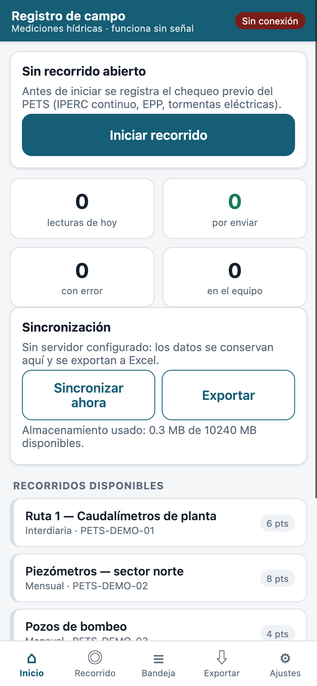
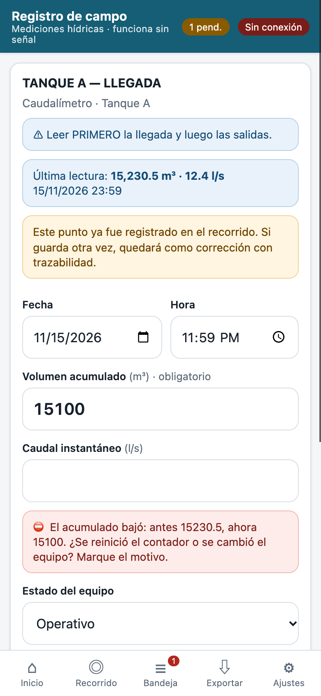

# Offline field logging

[](https://github.com/edpauce/registro-campo-offline/actions/workflows/tests.yml)

An installable web app (PWA) for recording water measurements in the field (flow meters,
piezometers, wells, treatment plant, flow gauging, staff gauges and weather) **where there is
no signal**. Ten HTML, CSS and JavaScript files, about 115 KB in total, with no dependencies:
no npm, no CDN, no build step. Copy one folder to an HTTPS server and it works.

**Live demo:** [edpauce.github.io/registro-campo-offline](https://edpauce.github.io/registro-campo-offline/).
Open it once with signal, switch on airplane mode and keep using it.

> **Fictitious data.** The catalogue of points (`app/js/catalogo.js`) is an invented demo
> plant. Any resemblance of a name or code to a real operation is coincidental.

## The problem

In the field, signal is the exception. An app that saves by sending to a server fails right
there: without a network there is nowhere to save, the operator goes back to the notebook,
someone transcribes it at the office, and the errors show up weeks later, when the monthly
balance doesn't close and nobody remembers what was read.

The failure is not in the screen but in **where the data lives**. This app writes it to the
device first and sends it later. The network is a bonus, never a requirement for saving.

| Typical situation | With the app |
|---|---|
| Readings go into a notebook and are transcribed at the office | Entered once, at the point |
| The error shows up at month-end close | It shows up in front of the equipment, with the operator there |
| A gap in the record has no explanation | "Could not measure", with a reason |
| An Excel file with no authorship | Author, time, GPS, photo and fingerprint per value |
| No signal, no app | No signal, the app still opens and saves |

<p align="center">
  
  
  
</p>

*Screenshots generated by the automated test, with the network cut and the server stopped. The app interface is in Spanish.*

## What it does

- **Opens offline.** The service worker (`app/sw.js`) stores the app on the device the first
  time and serves it from cache.
- **Saves to the device first.** Every reading is written to IndexedDB (`app/js/db.js`)
  before any attempt to send it, and is queued.
- **Validates at the point, not at month-end.** A cumulative meter that goes backwards blocks
  saving until it is justified; a daily consumption far from the historical value (±40% by
  default) asks for a photo or a note; a cumulative value that doesn't change warns of a
  stuck meter; a level that jumps against the previous reading asks for confirmation; most
  fields have physical limits, and quality fields (pH, chlorine, turbidity) have an
  operating range.
- **Corrections don't overwrite.** They create a new linked version and leave the previous
  one voided and visible.
- **Follows the procedure.** A prior safety check, recorded with name and time, before the
  round; if a check is missing, the round is flagged "with observations". Points appear in
  procedure order (for a tank, the inflow before the outflows).
- **Photo in the field, data entry at the desk** for long sheets: photograph the sheet or the
  panel and transcribe later with the photo fixed on screen. An optional number reader
  (`app/js/ocr.js`) **only suggests**: the user places each value by tapping it and checks it
  against the photo; nothing fills in by itself, because no reader is reliable on
  handwriting.
- **Excel generated on the phone** (`app/js/xlsx.js`), with no libraries: ZIP and OOXML
  written by hand, one sheet per record type (reservoirs and weather share one) plus a
  traceability sheet. Also CSV, with one column per measured field, and a `.json` backup to
  hand over a shift via WhatsApp or USB.
- **The backup is external data.** On import its full shape is validated (ids, dates, times,
  numbers, photos) and, if anything doesn't fit, it is rejected entirely. It does not carry
  the API key or the operator's ID number, and the rounds it brings are imported closed.
- **Idempotent sending** when there is a server: each reading travels with its id and its
  fingerprint; a resend after a signal drop doesn't duplicate.

## Design decisions

- **PWA, not an app-store app.** It installs from a link on Android, iPhone or PC, with no
  Play Store, App Store or per-user licence, and updates itself on publish.
- **Write first, network later.** It is the rule everything else follows from.
- **No dependencies.** Something that runs on a phone with no signal for years should not
  depend on a CDN or a build chain.
- **No background sending, on purpose.** iOS does not allow Background Sync. The app retries
  while open: on opening, when signal returns and every 2 minutes, without giving up after
  several failures. It doesn't promise what the operator's phone won't do.
- **Photos are not deleted on sending.** Photos don't travel to the server; "Free up space"
  only deletes those already inside an exported `.json` backup.
- **The automatic reader is an aid, not a replacement.** A misread balance value costs more
  than the minute it saves.
- **Traceability is part of the data.** Who, when, where, with which equipment and what
  happened to the previous value: what an ISO 9001 audit asks for (7.5, 9.1).

## Try it

Requires Python 3 (to serve it) and Node 22.2 or later (only for the tests).

```bash
npm start            # serves app/ at http://127.0.0.1:8000
```

Open it in Chrome, start a round, cut the network (DevTools ▸ Network ▸ Offline) and keep
recording. Don't open it with a double click (`file://`): that way the browser neither
installs nor stores it.

```bash
npm test             # validations, Excel/CSV generator and catalogue (node --test)
npm run test:e2e     # end to end in headless Chrome, offline
```

The end-to-end test (`tests/e2e/sin-conexion.mjs`) drives Chrome through the DevTools
protocol, without Puppeteer or Playwright: it loads the app, **cuts the network and stops the
server**, reloads, records readings, checks that a cumulative value going backwards is not
saved without a reason, exports an Excel file whose ZIP it verifies part by part, tries to
import a backup with malicious HTML and, when the network returns, checks that two
simultaneous syncs don't duplicate the sending. It runs on GitHub Actions on every push to
`main` and every pull request.

To use it on a phone it must be published over **HTTPS** (the only requirement) and, on
iPhone, installed with *Share ▸ Add to Home Screen*, which is what enables protected storage.

## Structure

```
app/
├── index.html            interface (single page)
├── estilos.css           high contrast, large buttons for use with gloves
├── manifest.webmanifest  installation data
├── sw.js                 service worker: opens offline
├── icono.svg
└── js/
    ├── catalogo.js       measurement types, routes and points (demo)
    ├── db.js             IndexedDB, validations, send queue, backup
    ├── xlsx.js           Excel and CSV generator with no libraries
    ├── ocr.js            optional number reader, with mandatory confirmation
    └── app.js            screens and flow
tests/                    node --test + e2e test in headless Chrome
```

## Adapting it to another operation

Replace `app/js/catalogo.js` with the real routes and points, in procedure order, and change
its `version`: on opening the app, each device replaces its catalogue with the new one
(readings already taken are not touched). Each measurement type declares its fields with
physical limits (`min`/`max`), operating range (`alerta`), whether it is a meter that never
goes backwards (`monotono`) and the maximum expected jump between readings (`saltoMax`). If
there is a server, *Settings ▸ Server* sets an endpoint that receives a `POST` with JSON per
reading and treats the `id` as the key.

## Alternatives worth looking at first

For many offline capture cases there are already mature tools:
[ODK](https://getodk.org), [KoboToolbox](https://www.kobotoolbox.org) (both open and based on
XLSForm forms) and [ArcGIS Survey123](https://survey123.arcgis.com) (commercial, integrated
with GIS). This app makes sense when what a generic form handles worse matters: validating
against **the history of the point itself** (cumulative values, daily consumption, level
jumps), rounds in a fixed order with a prior safety check, and an output already shaped like
the record the operation uses.

## Known limits

- No server included: sending is implemented and idempotent, but the tested output is Excel,
  CSV and the `.json` backup.
- No sending with the app closed (see design decisions).
- The number reader uses `TextDetector`, which in Chrome currently sits behind an
  experimental flag: in practice the button almost never appears and values are typed by hand.
- Photos are stored on the device and in the backup, not on the server.
- Verified in desktop Chrome (also headless). This version has not been tested installed on a
  physical phone.

## Author

Edson Palomino — [github.com/edpauce](https://github.com/edpauce)

## License

[MIT](LICENSE) license.

---

*Versión en español: [README.es.md](README.es.md)*
