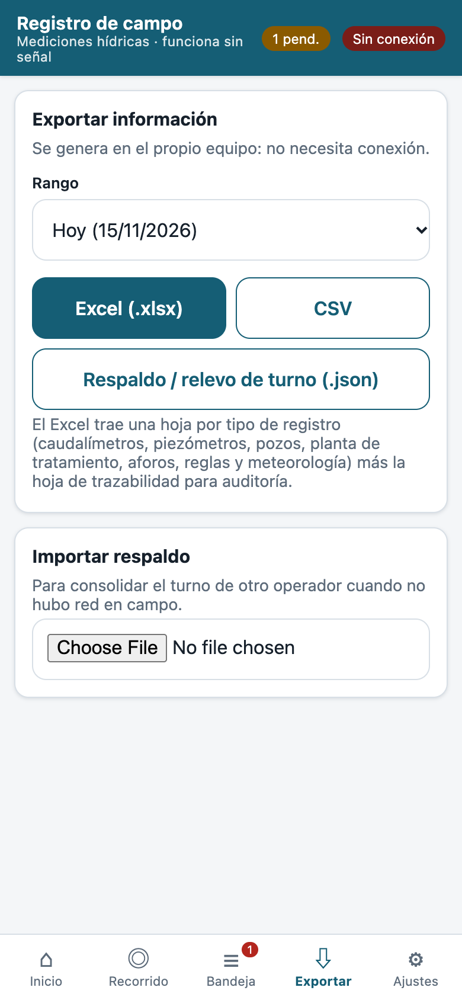

# Registro de campo sin conexión

[](https://github.com/edpauce/registro-campo-offline/actions/workflows/tests.yml)

App web instalable (PWA) para registrar mediciones hídricas en campo —caudalímetros,
piezómetros, pozos, planta de tratamiento, aforos, reglas y meteorología— **donde no hay
señal**. Diez archivos de HTML, CSS y JavaScript, unos 115 KB en total, sin dependencias:
no usa npm, CDN ni compilación. Se copia una carpeta a un servidor HTTPS y funciona.

> **Datos ficticios.** El catálogo de puntos (`app/js/catalogo.js`) es una planta de
> demostración inventada. Cualquier parecido de un nombre o código con una operación real
> es casual.

## El problema

En campo la señal es la excepción. Una app que guarda enviando al servidor falla justo
ahí: sin red no hay dónde guardar, el operador vuelve al cuaderno, alguien transcribe en
la oficina y los errores aparecen semanas después, cuando el balance del mes no cierra y
ya nadie recuerda qué se leyó.

El fallo no está en la pantalla sino en **dónde vive el dato**. Esta app lo escribe
primero en el equipo y lo envía después. La red es un extra, nunca un requisito para
guardar.

| Situación típica | Con la app |
|---|---|
| Se anota en cuaderno y se transcribe en oficina | Se digita una vez, en el punto |
| El error aparece al cerrar el mes | Aparece frente al equipo, con el operador ahí |
| Un vacío en el registro no tiene explicación | «No se pudo medir» con motivo |
| Un Excel sin autoría | Autor, hora, GPS, foto y huella por dato |
| Sin señal, no hay app | Sin señal, la app abre y guarda igual |

<p align="center">
  
  
  
</p>

*Capturas generadas por la prueba automática, con la red cortada y el servidor apagado.*

## Qué hace

- **Abre sin conexión.** El service worker (`app/sw.js`) guarda la app en el equipo la
  primera vez y la sirve desde caché.
- **Guarda primero en el equipo.** Cada lectura se escribe en IndexedDB (`app/js/db.js`)
  antes de cualquier intento de envío, y queda en una cola.
- **Valida en el punto, no a fin de mes.** Un contador acumulado que retrocede bloquea el
  guardado hasta justificarlo; un consumo diario lejos del histórico (±40 % por defecto)
  pide foto u observación; un acumulado que no varía avisa de equipo trabado; cada
  parámetro tiene límites físicos y rangos operativos (pH, cloro, turbidez…).
- **Las correcciones no sobrescriben.** Crean una versión nueva enlazada y dejan la
  anterior anulada y visible.
- **Sigue el procedimiento.** Chequeo previo de seguridad firmado antes del recorrido y
  puntos en el orden del procedimiento (en un tanque, la llegada antes que las salidas).
- **Foto en campo, digitación en gabinete** para hojas largas: se fotografía la hoja o el
  panel y se transcribe después con la foto fija en pantalla. Un lector de números
  opcional (`app/js/ocr.js`) propone valores **y obliga a confirmarlos**: sobre escritura
  a mano ningún lector es confiable.
- **Excel generado en el teléfono** (`app/js/xlsx.js`), sin librerías: ZIP y OOXML
  escritos a mano, una hoja por tipo de registro más una hoja de trazabilidad. También
  CSV y respaldo `.json` para traspasar un turno por WhatsApp o USB.
- **Envío idempotente** cuando hay servidor: cada lectura viaja con su id y su huella;
  un reenvío por corte de señal no duplica.

## Decisiones de diseño

- **PWA y no app de tienda.** Se instala desde un enlace en Android, iPhone o PC, sin
  Play Store, App Store ni licencia por usuario, y se actualiza sola al publicar.
- **Escritura primero, red después.** Es la regla de la que sale todo lo demás.
- **Sin dependencias.** Lo que corre en un celular sin señal durante años conviene que
  no dependa de un CDN ni de una cadena de compilación.
- **Sin envío en segundo plano, a propósito.** iOS no permite Background Sync. La app
  reintenta con la app abierta: al volver la señal, cada 2 minutos y al reabrirla. No
  promete lo que el teléfono del operador no va a hacer.
- **El lector automático es ayuda, no reemplazo.** Un dato de balance mal leído cuesta
  más que el minuto que ahorra.
- **La trazabilidad es parte del dato.** Quién, cuándo, dónde, con qué equipo y qué pasó
  con el valor anterior: lo que pregunta una auditoría ISO 9001 (7.5, 9.1).

## Probarla

Requiere Python 3 (para servirla) y Node 22 o superior (solo para los tests).

```bash
npm start            # sirve app/ en http://127.0.0.1:8000
```

Ábrela en Chrome, inicia un recorrido, corta la red (DevTools ▸ Network ▸ Offline) y
sigue registrando. No la abras con doble clic (`file://`): así el navegador no la
instala ni la guarda.

```bash
npm test             # validaciones, generador de Excel/CSV y catálogo (node --test)
npm run test:e2e     # punta a punta en Chrome headless, sin conexión
```

La prueba de punta a punta (`tests/e2e/sin-conexion.mjs`) usa Chrome por el protocolo
DevTools, sin Puppeteer ni Playwright: carga la app, **corta la red y apaga el
servidor**, recarga, registra lecturas, comprueba que un acumulado que retrocede no se
guarda sin motivo y exporta un Excel cuyo ZIP verifica parte por parte. Corre en cada
push en GitHub Actions.

Para usarla en un celular hay que publicarla con **HTTPS** (es lo único que exige) y,
en iPhone, instalarla con *Compartir ▸ Añadir a pantalla de inicio*, que es lo que
activa el almacenamiento protegido.

## Estructura

```
app/
├── index.html            interfaz (una sola página)
├── estilos.css           alto contraste, botones grandes para usar con guantes
├── manifest.webmanifest  datos de instalación
├── sw.js                 service worker: abre sin conexión
├── icono.svg
└── js/
    ├── catalogo.js       tipos de medición, rutas y puntos (demostración)
    ├── db.js             IndexedDB, validaciones, cola de envío, respaldo
    ├── xlsx.js           generador de Excel y CSV sin librerías
    ├── ocr.js            lector de números opcional, con confirmación obligatoria
    └── app.js            pantallas y flujo
tests/                    node --test + prueba e2e en Chrome headless
```

## Adaptarla a otra operación

Se reemplaza `app/js/catalogo.js` por las rutas y puntos reales, en el orden del
procedimiento, y se sube su `version`. Cada tipo de medición declara sus campos con
límites físicos (`min`/`max`), rango operativo (`alerta`), si es un contador que no
retrocede (`monotono`) y el salto máximo esperado entre lecturas (`saltoMax`). Si hay
servidor, en *Ajustes ▸ Servidor* se indica un endpoint que reciba un `POST` con JSON por
lectura y trate el `id` como clave.

## Alternativas que conviene mirar antes

Para muchos casos de captura sin conexión ya existen herramientas maduras:
[ODK](https://getodk.org), [KoboToolbox](https://www.kobotoolbox.org) (ambas abiertas y
basadas en formularios XLSForm) y [ArcGIS Survey123](https://survey123.arcgis.com)
(comercial, integrada con SIG). Esta app tiene sentido cuando importa lo que un
formulario genérico resuelve peor: validar contra la **historia del propio punto**
(acumulados, consumo diario, saltos de nivel), recorridos en un orden fijo con chequeo de
seguridad previo, y una salida que ya tiene la forma del registro que la operación usa.

## Límites conocidos

- No incluye servidor: el envío está implementado y es idempotente, pero la salida
  probada es Excel, CSV y respaldo `.json`.
- Sin envío con la app cerrada (ver decisiones).
- El lector de números depende de que el navegador exponga el detector de texto del
  sistema; donde no existe, el botón no aparece.
- Verificado en Chrome de escritorio (también headless). No se ha probado en esta versión
  instalada en un celular físico.

## Autor

Edson Palomino — [github.com/edpauce](https://github.com/edpauce)

## Licencia

Pendiente de definir.
